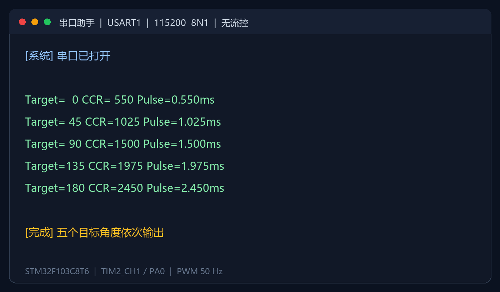
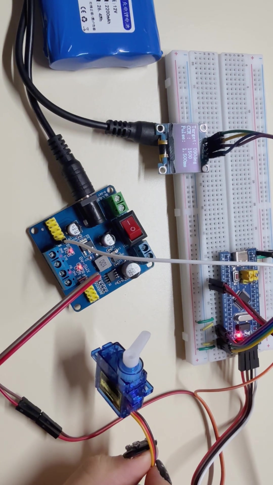

# RM-2027 电控培训第四次综合作业

使用 STM32F103C8T6 的 TIM2_CH1（PA0）输出 50 Hz PWM，驱动 180 度 SG90 舵机依次转到 0°、45°、90°、135°、180°。OLED 和 USART1 同步显示目标角度、CCR 与脉宽。

- GitHub 用户名：[@henshenmi](https://github.com/henshenmi)
- 仓库名称：`diankong4`
- 芯片：STM32F103C8T6
- 开发工具：STM32CubeMX、CLion、OpenOCD、ST-Link

## 功能

- PA0 / TIM2_CH1 输出 50 Hz PWM。
- 舵机按 `0° -> 45° -> 90° -> 135° -> 180°` 运动，每个位置停留 1 秒。
- OLED 显示 `Target / CCR / Pulse` 三行信息。
- USART1 以 115200 bit/s 输出相同信息。
- 角度输出限制在 SG90 的机械安全脉宽范围内。

## 时钟与 PWM 参数

TIM2 挂在 APB1 上。APB1 分频系数不为 1 时，F1 系列会把送给定时器的时钟自动乘 2，因此 TIM2 的计数时钟为 72 MHz。

```text
计数频率 = 72 MHz / (PSC + 1)
         = 72,000,000 / (71 + 1)
         = 1,000,000 Hz

一个计数 = 1 us

PWM 周期 = (ARR + 1) / 计数频率
         = (19999 + 1) / 1,000,000
         = 0.020 s
         = 20 ms

PWM 频率 = 1 / 20 ms = 50 Hz
```

因此配置为：

```text
PSC = 71
ARR = 19999
```

## 角度与 CCR 换算

SG90 的名义脉宽范围是 500 us 到 2500 us，但实际机械行程通常略窄。为了避免上电或运动到两端时顶住限位，本项目把可用脉宽压缩到 550 us 到 2450 us。

```text
CCR = 550 + angle / 180 × (2450 - 550)
```

| 目标角度 | CCR | 脉宽 |
|---:|---:|---:|
| 0° | 550 | 0.550 ms |
| 45° | 1025 | 1.025 ms |
| 90° | 1500 | 1.500 ms |
| 135° | 1975 | 1.975 ms |
| 180° | 2450 | 2.450 ms |

两端为什么不直接使用 500 us 和 2500 us：

- 不同 SG90 的实际行程存在个体差异。
- 打到机械限位会造成“咔咔”声、堵转和发热。
- 550 us 到 2450 us 对绝大多数 SG90 更安全，同时保留完整的可用转角范围。

## 接线

| 信号 | STM32 / 电源 |
|---|---|
| 舵机橙线（PWM） | PA0 / TIM2_CH1 |
| 舵机红线（5V） | 独立稳压 5V 正极 |
| 舵机棕线（GND） | 独立稳压 5V 负极 |
| 独立电源 GND | STM32 GND |
| OLED SCL | PB8 |
| OLED SDA | PB9 |
| OLED VCC / GND | 3.3V / GND |
| CH340 TXD | PA10 / USART1_RX |
| CH340 RXD | PA9 / USART1_TX |
| CH340 GND | STM32 GND |

注意：

- 舵机必须使用独立 5V 电源，不能接 STM32 板载 5V。
- 舵机电源与 STM32 必须共地。
- PA13 / PA14 保留给 SWD 下载。
- OLED 使用软件 IIC，不占用 TIM4。

## 工程结构

```text
Core/
  Inc/
    OLED.h
    OLED_Font.h
    Servo.h
  Src/
    OLED.c
    Servo.c
    main.c
    tim.c
    usart.c
CMakeLists.txt
four_project.ioc
cmake/
Drivers/
docs/
```

`CMakeLists.txt` 的用户源码部分已经包含：

```cmake
target_sources(${CMAKE_PROJECT_NAME} PRIVATE
    Core/Src/OLED.c
    Core/Src/Servo.c
)
```

## 编译与烧录

1. 用 CLion 打开根目录的 `CMakeLists.txt`。
2. 等待 CMake 加载完成。
3. 点击 Build。
4. 连接 ST-Link，点击 Run 烧录。

命令行构建：

```bash
cmake --preset Debug
cmake --build --preset Debug
```

## 运行结果

串口配置为 `115200、8N1、无流控`。程序输出格式：

```text
Target=  0 CCR= 550 Pulse=0.550ms
Target= 45 CCR=1025 Pulse=1.025ms
Target= 90 CCR=1500 Pulse=1.500ms
Target=135 CCR=1975 Pulse=1.975ms
Target=180 CCR=2450 Pulse=2.450ms
```

串口输出记录：



硬件联调画面：



演示视频：

[docs/demo_video.mp4](docs/demo_video.mp4)

## 主要源码

- `Core/Src/main.c`：初始化、五角度序列、OLED 与串口同步输出。
- `Core/Src/Servo.c`：角度限幅、CCR 换算和 PWM 启动。
- `Core/Src/OLED.c`：PB8/PB9 软件 IIC OLED 驱动。
- `four_project.ioc`：CubeMX 外设和时钟配置。

成长胜于输赢，初心高于胜负。
